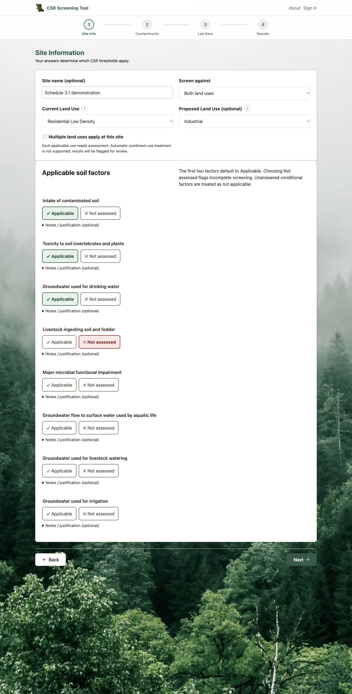
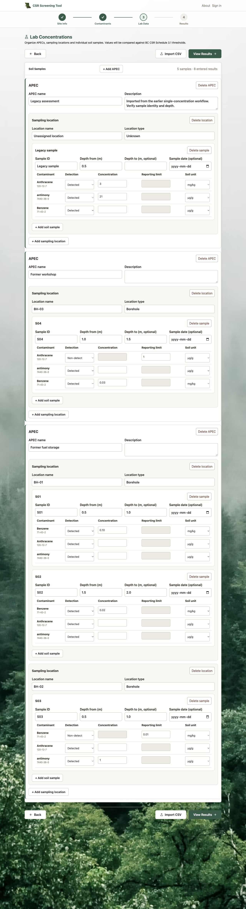
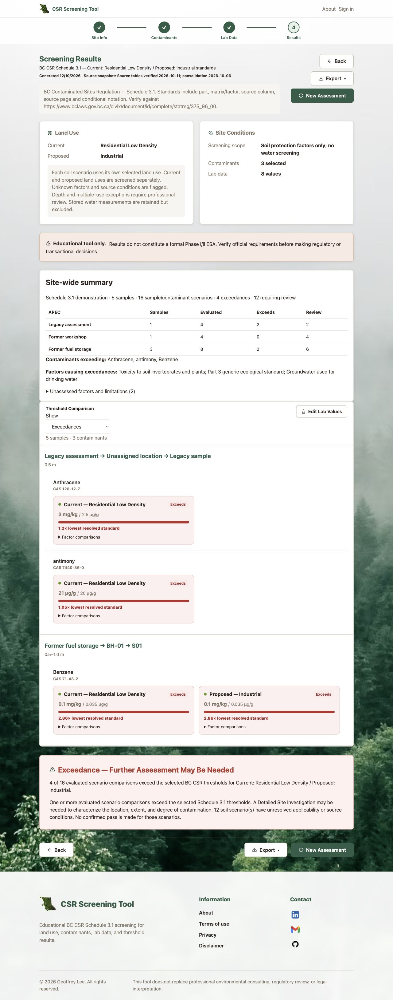

# Schedule 3.1 sample workflow — implementation and verification

Completed locally October 12, 2026. Nothing was pushed or deployed. This follows the original redesign prompt and the user's later two-option, editable-factor and compact-result decisions. Authentication and cloud account setup are retained; assessments still belong to browser storage, with no account sync.

## Completed workflow

- Site information: optional site name, required current CSR land use, optional proposed use, and Current/Proposed/Both mode. Proposed use is required only for a mode that evaluates it. All eight land uses remain available. Multiple-use sites are explicitly flagged for review; municipal zoning does not automatically establish CSR land use.
- All eight source-labelled factors are displayed with Applicable and Not assessed buttons. Soil intake and plant/invertebrate factors default to Applicable and remain editable. Marking either Not assessed prevents a confirmed Part 1 pass. Unanswered conditional factors are excluded as Not applicable at the user's explicit request; this is an assumption, not a Protocol 21 determination. Optional notes explain factors and save individual justifications.
- Site/profile → APEC → sampling location → soil sample → analytical results. Add, rename, edit and delete records; stable internal IDs preserve relationships when names or order change. Each sample has a user-facing sample ID, depth or depth interval and optional date. Deletion requires confirmation and removes children.
- Soil concentrations only, supported soil-unit conversions, Detected/Non-detect qualifiers and positive reporting limits. ND uses the reporting limit conservatively, never zero. A reporting limit above the standard gives Inconclusive, not a claimed exceedance. Samples are always compared individually, never averaged.
- Separate current/proposed comparisons for each sample/contaminant. Compact measured value, standard, status and ratio cards, grouped by APEC/location/sample. Optional factor tables show individual standards, status, ratios and a labelled star identifying the controlling numerical standard. Part 2/3 generic values retain their own structure, without artificial matrix-factor assignments.
- Site-wide and APEC summaries, exceeded contaminant and factor lists, uncertainties, and All/Exceedances/Requires review filters. Blank analytical placeholders do not clutter entered-result views.
- Multi-sample CSV preview validates all rows before an atomic import. The downloadable four-sample example is fictional. Quoted CSV fields, hierarchy IDs/names, dates, depths, units, contaminant matching, duplicate identifiers and conflicting sample metadata are checked. Equivalent numeric depths such as 1 and 1.0 match. Legacy concentration-only CSV is accepted only where its target sample is unambiguous.
- Browser autosave and schema version 4 migration. Prior soil measurements become a named legacy sample with unknown depth, not an invented depth. Previous water measurements remain stored and are excluded. The pre-migration state is retained in `bcCsrToolStateBeforeSamples`; clearing an assessment also clears that backup.
- CSV reports contain one row per analytical result, stable hierarchy IDs, lab units/qualifiers/reporting limits, scenario outcomes, individual factor JSON, source references, site ID and factor selections/justifications. Importing a report restores lab records; site assumptions must still be reviewed in Site Information.
- Word reports include sample identities/depth/date, scenario labels, individual applicable/unassessed factors, controlling standards, source/review notes and justifications. Printing temporarily includes all entered results and expands factor/limitation details, then restores the screen filter.
- Forest styling, mobile layouts, accessible native controls, validation feedback, CSV modal keyboard navigation and updated methodology/privacy descriptions. No new backend or runtime dependency was introduced.

## Regulatory data and documented limits

The earlier source-backed engine/data stage is described in `schedule31-implementation.md`. The catalogue contains 40 Part 1 matrix substances and 528 generic identities; Parts 2 and 3 each contain 527 source rows with differing coverage preserved. Source pages, columns, raw notation, conditions, URLs and PDF hashes remain in data.json. The government consolidation checked this turn was current to October 6, 2026, last amended July 1, 2026. No Schedule 3.2 water values are used.

Complex pH/species/TEQ/activity/Kd/hardness/temperature/special-unit conditions and unsupported notation require review; the engine preserves these conditions and does not infer an automatic interpretation. Missing depth, depths greater than 3 m, multiple-use treatment, unassessed factors, blank source values and missing counterpart generic rows are flagged. NS is distinct from blank and never zero. A known exceedance remains visible even if other factors are unresolved. All outcomes are screening results, not definitive compliance or remediation decisions.

Data generation and automated comparisons were verified, including original soil-intake and generic audit coverage; this is not an exhaustive independent manual certification of every regulatory cell. Protocol 21 determinations remain the assessor's responsibility. The prior official Protocol 21 PDF was consulted; a fresh fetch of its government PDF failed during this run.

## Verification completed

- `node --test tests/*.test.cjs`: 42 passing tests, including existing authentication tests. Covers all fourteen requested test categories through shared-engine, model/import and report checks. No production credentials or account records were modified.
- Real browser workflow in a hidden Codex browser: changed modes and editable mandatory factors, added/renamed APEC/location/sample records, entered concentrations, caught negative values and missing ND limits, corrected them, reloaded and verified persistence, previewed/applied the four-sample CSV and checked resulting five-sample assessment.
- Browser examples: residential anthracene 3 mg/kg exceeds 2.5 µg/g; antimony 21 µg/g exceeds the Part 3 value of 20 µg/g; antimony 1 µg/g passes; benzene 0.1 mg/kg exceeds its applicable drinking-water protection soil standard of 0.035 µg/g. These are fictional test measurements. Changing to Both produced separate current/proposed cards and recalculated scenario counts.
- Mobile viewport 390 × 844 and desktop 1280: no page-level horizontal overflow. Tables can scroll within their containers. Saved screenshots were visually inspected. No browser JavaScript errors were observed in the final results check.
- Current Word export code with the same docx 8.5 library generated a two-sample, two-scenario demonstration. All three rendered pages were visually inspected: all columns fit, headers repeat, ND labels and controlling standards are present. `sample-report.docx` and its rendered `sample-report-preview.pdf` contain only fictional demonstration data.
- CSV export/reimport tested, including ND inactive-value omission and provenance. Print-all/filter restoration tested. JavaScript/Python syntax, local HTML references, shared Python lookup and whitespace checks passed.

Native Microsoft Word, physical mobile devices and the browser's native Save as PDF dialog were not tested. The included PDF is a rendered Word preview, not evidence of the website's native PDF-save flow. Actual browser download delivery was verified in the earlier engine stage; this stage checks current export generation/content and Word rendering.

## Review the changes

1. Open assessment.html with Live Server: try Current without proposed use, Both with proposed use, and editable mandatory factors.
2. Select contaminants; in Lab Data add an APEC, location and two samples. Enter distinct concentrations or an ND/reporting limit. Reload to confirm saved progress.
3. Import sample-import-template.csv after previewing its fictional rows.
4. Review results by sample, expand Factor comparisons, and try the result filters.
5. Inspect CSV/Word exports and the native print/PDF flow in your preferred browser before publishing.

Mobile evidence: [sample entry](sample-entry-mobile.jpg), [results](sample-results-mobile.jpg).

## Main changed files

- assessment.html, script.js: site information, factor controls, justifications.
- data-utils.js: shared screening, model, validation, import, migration and storage.
- labdata.html, labdata.js, sample-import-template.csv: sample editor and import UI.
- results.html, results.js: grouped results, summaries, factors, filters and exports.
- style.css: sample layout, validation, responsive tables and print rules.
- about.html, contaminants.html, privacypolicy.html: scope, methods and browser-data descriptions; remaining workflow pages have refreshed asset versions.
- tests/screening.test.cjs and verification/: regression coverage and evidence.
- Earlier data.json, query.py, contaminants.js and verification/build-schedule31.py: source-backed regulatory stage carried forward.
